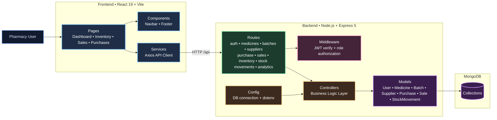

# 💊 Pharmacy Inventory System

<p align="center">
  A full-stack pharmacy operations platform for medicine cataloging, batch-level stock control,
  purchase/sales tracking, expiry visibility, and role-based workflows.
</p>

<p align="center">
  
  
  
  
  
</p>

---

## Table of Contents

- [Why this project](#why-this-project)
- [Feature overview](#feature-overview)
- [Key workflows](#key-workflows)
- [Architecture](#architecture)
- [Tech stack](#tech-stack)
- [Repository structure](#repository-structure)
- [Getting started](#getting-started)
  - [Prerequisites](#prerequisites)
  - [Installation](#installation)
  - [Environment variables](#environment-variables)
  - [Run locally](#run-locally)
  - [Build and lint commands](#build-and-lint-commands)
  - [Expected local URLs](#expected-local-urls)
- [API route overview](#api-route-overview)
- [Core domain models](#core-domain-models)
- [Security notes](#security-notes)
- [Development conventions](#development-conventions)
- [Troubleshooting](#troubleshooting)
- [Screenshots / demo](#screenshots--demo)
- [Contributing](#contributing)
- [Roadmap](#roadmap)

---

## Why this project

This repository contains a JavaScript full-stack pharmacy inventory system designed to centralize day-to-day pharmacy operations:

- Medicine master data management
- Batch-wise inventory control
- Supplier and purchase recording
- Sales and stock movement traceability
- Expiry-risk and reorder visibility
- Role-based access (Admin, Pharmacist, Cashier)

---

## Feature overview

### Inventory & medicines
- Manage medicine records with product attributes and safety thresholds.
- Track stock at **batch level** with quantities, pricing, and expiry dates.
- Query consolidated inventory and medicine-specific inventory views.

### Suppliers & procurement
- Maintain supplier profiles.
- Record purchase transactions with itemized medicine/batch details.
- Tie purchases to invoice metadata for traceable replenishment.

### Sales & movement tracking
- Process sales with stock-aware flows.
- Maintain sale history and item details.
- Track stock movements for auditability.

### Insights
- Dashboard-oriented analytics endpoints.
- Reorder recommendation endpoints.
- Expiry risk endpoints for proactive stock handling.

### Authentication & access
- JWT-based auth flows.
- Password hashing via bcryptjs.
- Role-based middleware authorization for API routes.

---

## Key workflows

```mermaid
flowchart LR
    classDef auth fill:#3c2a6f,stroke:#b89cff,stroke-width:2px,color:#fff;
    classDef master fill:#0f3a5a,stroke:#69d2ff,stroke-width:2px,color:#fff;
    classDef procurement fill:#214a2d,stroke:#80f2a8,stroke-width:2px,color:#fff;
    classDef sales fill:#5a2b2b,stroke:#ff9ea1,stroke-width:2px,color:#fff;
    classDef tracking fill:#5e4a1d,stroke:#f8d57e,stroke-width:2px,color:#fff;
    classDef insights fill:#4a235b,stroke:#e8a3ff,stroke-width:2px,color:#fff;

    A[User logs in] --> B{Role authorized?}
    B -->|No| C[Access denied]
    B -->|Yes| D[Create/manage medicines]
    D --> E[Manage suppliers]
    E --> F[Record purchases]
    F --> G[Create/update batches]
    G --> H[Inventory updated]
    H --> I[Process sales]
    I --> J[Stock movement recorded]
    J --> K[Expiry monitoring]
    J --> L[Reorder recommendations]

    class A,B,C auth;
    class D,E master;
    class F,G procurement;
    class I sales;
    class H,J,K tracking;
    class L insights;
```



---

## Architecture

### Clustered application architecture (GitHub Mermaid)



### Request/data flow summary
1. Frontend pages call the Axios service client.
2. Express route handlers receive API requests under `/api/*`.
3. Middleware verifies JWT and allowed roles where required.
4. Controllers run domain logic and interact with Mongoose models.
5. Models persist and query data in MongoDB.

---

## Tech stack

### Frontend

| Area | Technology |
| --- | --- |
| UI framework | React 19 |
| Build tool | Vite |
| Routing | React Router |
| HTTP client | Axios |
| Styling | Tailwind CSS |

### Backend

| Area | Technology |
| --- | --- |
| Runtime | Node.js |
| Server framework | Express 5 |
| Database | MongoDB |
| ODM | Mongoose |
| Auth | jsonwebtoken (JWT), bcryptjs |
| Middleware/utilities | cors, dotenv |

---

## Repository structure

```text
pharmacy-inventory-system/
├── README.md
├── backend/
│   ├── config/
│   │   └── db.js
│   ├── controllers/
│   ├── middleware/
│   │   └── authMiddleware.js
│   ├── models/
│   ├── routes/
│   ├── server.js
│   └── package.json
└── frontend/
    ├── public/
    ├── src/
    │   ├── components/
    │   ├── pages/
    │   ├── services/
    │   │   └── api.js
    │   ├── App.jsx
    │   └── main.jsx
    ├── index.html
    └── package.json
```

---

## Getting started

### Prerequisites

- Node.js 18+
- npm
- MongoDB instance (local or Atlas)

### Installation

From repository root:

```bash
# Install backend dependencies
cd backend
npm install

# Install frontend dependencies
cd ../frontend
npm install
```

### Environment variables

Create `backend/.env`:

```env
PORT=5000
MONGO_URI=mongodb+srv://<username>:<password>@<cluster>/<database>
JWT_SECRET=<your_jwt_secret>
```

Optional frontend variable (if not using defaults in `src/services/api.js`):

Create `frontend/.env`:

```env
VITE_API_URL=http://localhost:5000/api
```

### Run locally

> Start backend and frontend in **separate terminals**.

Terminal 1 (backend):

```bash
cd backend
npm start
```

Terminal 2 (frontend):

```bash
cd frontend
npm run dev
```

### Build and lint commands

Frontend:

```bash
cd frontend
npm run lint
npm run build
npm run preview
```

Backend:

```bash
cd backend
npm start
```

> The backend package currently does not define dedicated lint/build scripts.

### Expected local URLs

- Frontend (Vite dev): `http://localhost:5173`
- Backend API: `http://localhost:5000`
- Backend health/root: `GET http://localhost:5000/`

---

## API route overview

> **Overview only**: based on the current `backend/server.js` route mounts and files in `backend/routes`. Endpoint details can evolve with controller logic.

| Base route | Purpose |
| --- | --- |
| `/api/auth` | Authentication and user setup routes |
| `/api/medicines` | Medicine CRUD and listing |
| `/api/batches` | Batch CRUD and medicine batch lookup |
| `/api/suppliers` | Supplier management |
| `/api/purchase` | Purchase creation and retrieval |
| `/api/sales` | Sales creation and retrieval |
| `/api/inventory` | Inventory views |
| `/api/stockMovements` | Stock movement history |
| `/api/analytics` | Dashboard, reorder, and expiry analytics |

Auth routes currently include:
- `POST /api/auth/register`
- `POST /api/auth/login`
- `POST /api/auth/setup-admin`

---

## Core domain models

| Model | Role in system | Key relationships |
| --- | --- | --- |
| `User` | Authentication identity and role | Role drives authorization middleware |
| `Medicine` | Master medicine catalog | Referenced by `Batch`, `Purchase.items`, `Sale.items`, `StockMovement` |
| `Batch` | Physical inventory lots with expiry/pricing | References `Medicine`; referenced by `Sale.items` and `StockMovement` |
| `Supplier` | Vendor/source of medicines | Referenced by `Purchase` |
| `Purchase` | Inbound stock transactions | References `Supplier`; embeds item rows pointing to `Medicine` |
| `Sale` | Outbound stock transactions | Embeds item rows referencing `Medicine` and `Batch` |
| `StockMovement` | Inventory audit trail entries | References `Medicine`, `Batch`, and optionally performer/reference |

### Relationship narrative
- **Purchases** replenish stock and contribute batch inventory.
- **Sales** consume inventory (typically batch-aware) and contribute movement history.
- **Analytics/inventory routes** aggregate model data into operational views (dashboard, expiry risk, reorder insights).

---

## Security notes

- Use strong `JWT_SECRET` values and keep them out of version control.
- Never commit `.env` files with real credentials.
- Passwords are hashed with bcryptjs before persistence.
- Protect sensitive routes with token verification and role checks.
- Review CORS policy for production domains before deployment.

---

## Development conventions

- Keep frontend and backend concerns separated by folder (`frontend/` and `backend/`).
- Add API logic by extending the existing **route → controller → model** structure.
- Keep environment-specific values in `.env`, not hard-coded in source.
- Prefer small, isolated changes and verify both app layers when behavior changes.

---

## Troubleshooting

- **MongoDB connection errors**: verify `MONGO_URI`, IP/network access, and database user permissions.
- **401/403 responses**: check JWT validity, login flow, and role authorizations.
- **CORS issues in browser**: confirm backend is running and CORS configuration matches frontend origin.
- **Frontend API failures**: verify `VITE_API_URL` and backend server URL/port.
- **Port conflicts**: change `PORT` in backend `.env` and update frontend API URL accordingly.

---

## Screenshots / demo

> Placeholder section (no real assets are included yet).

- `docs/images/dashboard-placeholder.png` *(placeholder)*
- `docs/images/inventory-placeholder.png` *(placeholder)*
- `docs/images/sales-placeholder.png` *(placeholder)*

---

## Contributing

1. Fork the repository.
2. Create a feature branch.
3. Make focused changes with clear commit messages.
4. Open a pull request with implementation details and test notes.

---

## Roadmap

- Barcode/QR-assisted medicine lookup
- Invoice print/PDF support
- Better alerting channels (email/SMS/in-app)
- Multi-store or multi-branch inventory support
- Richer reporting/export options
- Stronger audit and reconciliation workflows

