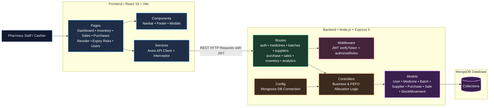

# 💊 PharmaSys — Pharmacy Management & Inventory System

<p align="center">
  A full-stack pharmacy operations platform for medicine cataloging, batch-level stock control,
  automated FEFO dispensing, procurement tracking, expiry risk visibility, and role-based workflows.
</p>

<p align="center">
  
  
  
  
  
</p>

---

## Table of Contents

- [Overview](#overview)
- [Key Features](#key-features)
- [Tech Stack](#tech-stack)
- [System Architecture](#system-architecture)
- [Core Engineering Decisions](#core-engineering-decisions)
- [Key Workflows](#key-workflows)
- [Project Structure](#project-structure)
- [Prerequisites & Installation](#prerequisites--installation)
- [Environment Variables](#environment-variables)
- [Local Development](#local-development)
- [Roles & Permissions](#roles--permissions)
- [API Reference](#api-reference)
- [Core Domain Models](#core-domain-models)
- [Security Considerations](#security-considerations)
- [Current Limitations](#current-limitations)
- [Future Improvements](#future-improvements)
- [Author & License](#author--license)

---

## Overview

In healthcare and pharmaceutical retail, inventory failure directly impacts patient safety and business viability:
- **Expired Stock Dispensation**: Selling expired drugs leads to severe medical liabilities and licensing violations.
- **Stockouts of Life-Saving Meds**: Inability to anticipate replenishment leads to sudden stock exhaustion during critical patient needs.
- **Batch & Pricing Inconsistencies**: The same drug purchased in different lots often arrives at different cost and selling prices.
- **Audit Trail Gaps**: Inability to identify which staff member dispensed or adjusted a particular batch lot creates compliance risks.

**PharmaSys** addresses these challenges within a clean, decoupled full-stack architecture using automated **FEFO (First-Expired, First-Out)** batch allocation, real-time demand-driven reorder points, tiered expiry alerts, and immutable stock movement logging.

---

## Key Features

### Point-of-Sale (POS) & Billing
- **Dynamic Medicine Search**: Instant lookup by brand name, generic name, or therapeutic category.
- **Automated FEFO Allocation**: The system automatically pulls from unexpired batches expiring soonest, calculating the blended customer price in real time.
- **Customer Details Capture**: Optional customer name and phone number recording for traceable patient receipts.
- **Instant Printable Receipt**: In-app modal with formatted invoice numbers, itemized line totals, batch tracking, and totals.

### Batch-Wise Inventory & Procurement
- **Two-Tiered Stock Architecture**: Master medicines catalog separated from physical batch lots.
- **Inbound Purchase Management**: Receive inventory linked to suppliers, batch numbers, manufacturer expiry dates, purchase costs, and selling prices.
- **Real-Time Stock Status**: Color-coded badges for *In Stock*, *Low Stock*, and *Expired*.
- **Safe Deletion Guards**: Medicines and suppliers with active historical transactions or batch references are protected against accidental deletion.

### Analytical Insights & Clinical Safety
- **Executive Metrics Dashboard**: Summary cards for total catalog medicines, active stock units, low-stock warnings, expiring batches, and daily sales revenue.
- **Tiered Expiry Risk Matrix**: Proactive classification of stock into *Expired*, *Critical (< 7 days)*, *High Risk (7–30 days)*, *Upcoming (< 90 days)*, and *Safe*, including estimated financial value at risk.
- **Smart Reorder Forecasting**: Considers 30-day historical consumption velocity (average daily demand) and supplier lead times to suggest exact order quantities.

### Security & Access Control
- **Role-Based Workflows**: Distinct privilege levels for **Admin**, **Pharmacist**, and **Cashier**.
- **First-Account Provisioning**: The very first registered user is automatically elevated to Admin; all subsequent signups default to Cashier unless elevated by an Admin.
- **Audited Stock Movements**: Every sale, purchase, or manual correction automatically creates an unalterable audit log entry referencing the staff member responsible.

---

## Tech Stack

| Domain | Technology | Purpose |
| --- | --- | --- |
| **Frontend Framework** | React 19 + Vite | High-performance Single Page Application with client-side routing |
| **Client Routing** | React Router 7 | Declarative role-protected route hierarchy |
| **HTTP Client** | Axios | REST client with automatic JWT bearer token interceptor |
| **Styling & Design** | Tailwind CSS 4 | Modern, responsive dashboard and POS interface |
| **Backend Runtime** | Node.js (v18+) | Non-blocking asynchronous server runtime |
| **Web Framework** | Express 5 | RESTful API server with custom error handling and middleware |
| **Database & ODM** | MongoDB + Mongoose 9 | Document database with relational schema references and validators |
| **Authentication** | JSON Web Tokens (JWT) | Stateless token-based session verification (1-day expiry) |
| **Password Security** | bcryptjs | Salted password hashing (10 salt rounds) |
| **Cross-Origin Handling** | CORS | Configurable resource sharing middleware |

---

## System Architecture

### Clustered Application Architecture



### Request/Data Flow Summary
1. Client components trigger API requests via the configured Axios instance.
2. The Axios request interceptor automatically injects the user's JWT from `localStorage`.
3. Express routes pass requests through `verifyToken` and `authorizeRoles(...)` middleware.
4. Controllers execute validation and domain logic (e.g., verifying stock availability across batches).
5. Mongoose models persist transactions, decrement batch stocks, and write immutable audit movement records.

---

## Core Engineering Decisions

### 1. Automated FEFO (First-Expired, First-Out) Stock Dispensation
- **Decision**: Sales do not allow manual batch selection by cashiers; the server automatically queries unexpired batches sorted chronologically by `expiryDate: 1`.
- **Rationale**: In busy pharmacy environments, cashiers naturally grab whichever box is physically closest. Enforcing automated FEFO at the API level ensures that older stock is cleared first, drastically reducing product expiry waste and preventing the accidental sale of expired medication.

### 2. In-Memory Calculation Before Database Mutation
- **Decision**: In `saleController.js`, batch deduction amounts and item totals are calculated completely in memory. The `Sale` document is created **before** updating batch quantities in MongoDB.
- **Rationale**: Traditional multi-step updates can corrupt inventory if an intermediate operation fails. By calculating the plan in memory and saving the sale document first, a failed sale never leaves batches partially decremented without a corresponding invoice.

### 3. Separation of Medicine Catalog from Physical Batches
- **Decision**: Medicines (`Medicine`) store static clinical attributes (generic name, category, manufacturer, prescription requirement, reorder levels). Physical quantities, purchase costs, selling prices, and expiry dates are stored separately in `Batch`.
- **Rationale**: A pharmacy sells the same medicine acquired from different suppliers at varying costs and expiry dates over time. Coupling stock directly to the medicine model would make lot traceability and profit-margin calculations impossible.

### 4. Immutable Audit Trail via Stock Movements
- **Decision**: Direct balance adjustments do not occur in isolation. Every purchase, customer sale, or manual inventory correction generates an immutable `StockMovement` record with `quantity`, `type` (`PURCHASE` / `SALE` / `ADJUSTMENT`), and `performedBy`.
- **Rationale**: Regulatory compliance requires accountability for every unit entering or leaving a pharmacy.

### 5. Dynamic Demand-Based Reorder Forecasting
- **Decision**: Reorder recommendations do not rely solely on static minimums. They compute:
  $$\text{Average Daily Demand} = \frac{\text{Sales in past 30 days}}{30}$$
  $$\text{Reorder Point} = (\text{Average Daily Demand} \times \text{Lead Time}) + \text{Safety Stock}$$
- **Rationale**: Fixed static thresholds fail during sudden demand spikes or seasonal illnesses. Dynamic calculations account for actual consumption speed and supplier delivery lead times.

---

## Key Workflows

```mermaid
flowchart LR
    classDef auth fill:#3c2a6f,stroke:#b89cff,stroke-width:2px,color:#fff;
    classDef master fill:#0f3a5a,stroke:#69d2ff,stroke-width:2px,color:#fff;
    classDef procurement fill:#214a2d,stroke:#80f2a8,stroke-width:2px,color:#fff;
    classDef sales fill:#5a2b2b,stroke:#ff9ea1,stroke-width:2px,color:#fff;
    classDef tracking fill:#5e4a1d,stroke:#f8d57e,stroke-width:2px,color:#fff;
    classDef insights fill:#4a235b,stroke:#e8a3ff,stroke-width:2px,color:#fff;

    A[User logs in] --> B{Role authorized?}
    B -->|No| C[Access denied]
    B -->|Yes| D[Create/manage medicines]
    D --> E[Manage suppliers]
    E --> F[Record purchases]
    F --> G[Create/update batches]
    G --> H[Inventory updated]
    H --> I[Process sales via FEFO]
    I --> J[Stock movement logged]
    J --> K[Expiry monitoring updated]
    J --> L[Reorder recommendations updated]

    class A,B,C auth;
    class D,E master;
    class F,G procurement;
    class I sales;
    class H,J,K tracking;
    class L insights;
```



---

## Project Structure

```text
PharmaSys/
├── backend/
│   ├── config/
│   │   └── db.js                       # Mongoose MongoDB connection
│   ├── controllers/
│   │   ├── analyticsController.js      # Dashboard stats, reorder & expiry risks
│   │   ├── authController.js           # Signup, login & staff account management
│   │   ├── batchController.js          # Direct batch CRUD & lookups
│   │   ├── inventoryController.js      # Consolidated stock & medicine views
│   │   ├── medicineController.js       # Master medicine catalog CRUD
│   │   ├── purchaseController.js       # Procurement intake & batch generation
│   │   ├── saleController.js           # POS billing, FEFO deduction & audit
│   │   ├── stockMovementController.js  # Audit trail retrieval
│   │   └── supplierController.js       # Vendor profile management
│   ├── middleware/
│   │   └── authMiddleware.js           # JWT verification & role authorization
│   ├── models/
│   │   ├── batch.js                    # Batch schema (expiry, quantity, prices)
│   │   ├── medicine.js                 # Master medicine schema
│   │   ├── purchase.js                 # Inbound purchase invoice schema
│   │   ├── sale.js                     # Outbound sale invoice schema
│   │   ├── stockMovement.js            # Audit movement schema
│   │   ├── supplier.js                 # Supplier directory schema
│   │   └── user.js                     # User schema with bcrypt hook
│   ├── routes/                         # Express route definitions
│   ├── .env.example
│   ├── package.json
│   └── server.js                       # API entrypoint & route mounting
├── frontend/
│   ├── public/
│   │   ├── _redirects                  # SPA fallback routing (Netlify/Render)
│   │   └── favicon.svg
│   ├── src/
│   │   ├── components/                 # Navbar, Footer
│   │   ├── pages/                      # Dashboard, Inventory, Sales, etc.
│   │   ├── services/
│   │   │   └── api.js                  # Axios client with JWT interceptor
│   │   ├── utils/
│   │   │   └── auth.js                 # Token & user session helpers
│   │   ├── App.jsx                     # Route definitions & ProtectedRoute
│   │   ├── main.jsx                    # Application entry
│   │   └── index.css                   # Tailwind CSS styling
│   ├── .env.example
│   ├── vercel.json                     # SPA rewrite configuration for Vercel
│   ├── vite.config.js
│   └── package.json
├── .gitignore
├── PROJECT_REPORT.md
└── README.md
```

---

## Prerequisites & Installation

### Prerequisites
- **Node.js**: Version 18.x or newer
- **npm**: Version 9.x or newer
- **MongoDB**: Local MongoDB instance or MongoDB Atlas cluster connection

### Installation
Clone the repository and install dependencies for both applications:

```bash
# Clone the repository
git clone https://github.com/Anuj-codee/PharmaSys.git
cd PharmaSys

# Install backend dependencies
cd backend
npm install

# Install frontend dependencies
cd ../frontend
npm install
```

---

## Environment Variables

### Backend (`backend/.env`)
Create a `.env` file in the `backend/` directory based on [backend/.env.example](file:///d:/Pharmacy%20management/PharmaSys/backend/.env.example):

```env
PORT=5000
MONGO_URI=mongodb+srv://<username>:<password>@cluster.mongodb.net/pharmasys
JWT_SECRET=your_super_secret_jwt_key_here
```

### Frontend (`frontend/.env`)
Create a `.env` file in the `frontend/` directory based on [frontend/.env.example](file:///d:/Pharmacy%20management/PharmaSys/frontend/.env.example):

```env
VITE_API_URL=http://localhost:5000/api
```

> **Security Note**: Never commit actual `.env` files. Both `backend/.env` and `frontend/.env` are ignored by `.gitignore`.

---

## Local Development

Start the backend and frontend in separate terminals:

**Terminal 1 — Backend:**
```bash
cd backend
npm run dev     # Starts with nodemon on http://localhost:5000
# or: npm start # Starts with plain node
```

**Terminal 2 — Frontend:**
```bash
cd frontend
npm run dev     # Starts Vite dev server on http://localhost:5173
```

### Build, Lint & Test Commands
```bash
# Frontend
cd frontend
npm run lint    # Run ESLint checks
npm run build   # Compile production bundle into dist/
npm run preview # Preview production build locally

# Backend
cd backend
npm test        # Run automated unit & business logic tests
```

---

## Roles & Permissions

| Feature / Page | Admin | Pharmacist | Cashier |
| :--- | :---: | :---: | :---: |
| **Sales & Billing (`/sales`)** | ✅ | ✅ | ✅ |
| **Inventory View (`/inventory`)** | ✅ | ✅ | ✅ |
| **Medicine List (`/medicines`)** | ✅ | ✅ | ✅ |
| **Add / Edit / Delete Medicines** | ✅ | ✅ | ❌ |
| **Dashboard Analytics (`/dashboard`)** | ✅ | ✅ | ❌ |
| **Expiry Risks (`/expiry-risks`)** | ✅ | ✅ | ❌ |
| **Smart Reorder (`/recommendations`)** | ✅ | ✅ | ❌ |
| **Stock Audit Trail (`/audit-trail`)** | ✅ | ✅ | ❌ |
| **View Suppliers & Purchase History** | ✅ | ✅ | ❌ |
| **Record New Purchases (`/purchases`)** | ✅ | ❌ | ❌ |
| **Manage Staff Accounts (`/users`)** | ✅ | ❌ | ❌ |

---

## API Reference

Base URL prefix: `/api`. Protected routes require a valid JWT token in the `Authorization` header (`Bearer <token>`).

### Authentication & Staff Management (`/api/auth`)
| Method | Endpoint | Access | Description |
| --- | --- | --- | --- |
| `POST` | `/api/auth/register` | Public | First signup becomes Admin; subsequent signups become Cashier |
| `POST` | `/api/auth/login` | Public | Authenticates user and returns JWT token + user details |
| `GET` | `/api/auth/users` | Admin | List all staff accounts (passwords excluded) |
| `POST` | `/api/auth/users` | Admin | Create a staff account with a designated role |
| `PUT` | `/api/auth/users/:id/role` | Admin | Update a staff member's role |
| `DELETE` | `/api/auth/users/:id` | Admin | Delete a staff account |

### Medicines Catalog (`/api/medicines`)
| Method | Endpoint | Access | Description |
| --- | --- | --- | --- |
| `GET` | `/api/medicines` | All Staff | Paginated list of medicines with search filter |
| `GET` | `/api/medicines/:id` | All Staff | Fetch single medicine details |
| `POST` | `/api/medicines` | Admin, Pharmacist | Create new medicine in master catalog |
| `PUT` | `/api/medicines/:id` | Admin, Pharmacist | Update medicine details |
| `DELETE` | `/api/medicines/:id` | Admin, Pharmacist | Delete medicine (blocked if active batches exist) |

### Purchases & Procurement (`/api/purchase`)
| Method | Endpoint | Access | Description |
| --- | --- | --- | --- |
| `POST` | `/api/purchase` | Admin | Record supplier invoice purchase, create/update batches, log audit trail |
| `GET` | `/api/purchase` | Admin, Pharmacist | View all historical purchase records |
| `GET` | `/api/purchase/:id` | Admin, Pharmacist | Fetch details of a specific purchase invoice |

### Sales & POS Billing (`/api/sales`)
| Method | Endpoint | Access | Description |
| --- | --- | --- | --- |
| `POST` | `/api/sales` | All Staff | Create a sale invoice, deduct unexpired stock via FEFO, log audit trail |
| `GET` | `/api/sales` | All Staff | Fetch recent sales transactions |
| `GET` | `/api/sales/:id` | All Staff | Fetch single sale invoice breakdown |

### Inventory & Stock Movements (`/api/inventory`, `/api/stockMovements`)
| Method | Endpoint | Access | Description |
| --- | --- | --- | --- |
| `GET` | `/api/inventory` | All Staff | Consolidated inventory batches with expiry and low-stock flags |
| `GET` | `/api/inventory/medicine/:medicineId` | All Staff | Total unexpired stock for a single medicine |
| `GET` | `/api/stockMovements` | Admin, Pharmacist | Audit trail of all stock movements with performer references |

### Analytics & Insights (`/api/analytics`)
| Method | Endpoint | Access | Description |
| --- | --- | --- | --- |
| `GET` | `/api/analytics/dashboard` | All Staff | High-level metrics: medicines count, low stock, expiries, sales today |
| `GET` | `/api/analytics/reorder-recommendations` | Admin, Pharmacist | Dynamic replenishment suggestions based on daily sales velocity |
| `GET` | `/api/analytics/expiry-risks` | Admin, Pharmacist | Tiered batch risk classification (Expired, Critical, High Risk, Upcoming) |

---

## Core Domain Models

| Model | Role in System | Key Relationships |
| --- | --- | --- |
| `User` | Staff identity and permission tier | Drives route authorization middleware |
| `Medicine` | Master pharmaceutical product catalog | Referenced by `Batch`, `Purchase.items`, `Sale.items`, `StockMovement` |
| `Batch` | Physical stock lot with lot number and expiry | References `Medicine`; referenced by `Sale.items` and `StockMovement` |
| `Supplier` | Verified medicine distributor profile | Referenced by `Purchase` |
| `Purchase` | Inbound commercial transaction | References `Supplier`; embeds lines referencing `Medicine` |
| `Sale` | Outbound patient transaction | Embeds lines referencing `Medicine` and `Batch` |
| `StockMovement` | Immutable audit entry | References `Medicine`, `Batch`, and optionally the acting `User` |

---

## Security Considerations

- **Credential Hashing**: User passwords are encrypted with `bcryptjs` using 10 salt rounds in a Mongoose `pre-save` hook; passwords are never returned in API responses.
- **Stateless Authorization**: All protected endpoints enforce signed JWT tokens, preventing session hijacking or server-side state corruption.
- **Relational Integrity Checks**: Prevents deletion of suppliers or medicines that possess active purchase invoices or stock batches.
- **SPA Routing Protection**: `_redirects` and `vercel.json` are pre-configured to ensure clean route handling on modern cloud platforms.

---

## Current Limitations

- **Single-Location Inventory**: Currently tracks stock for a single pharmacy branch.
- **Hardware Integrations**: Barcode scanners and thermal ESC/POS receipt printers are not natively integrated; billing uses keyboard/mouse search and digital browser receipts.

---

## Future Improvements

- **Barcode / QR Code Scanner**: Direct scanning of GS1 DataMatrix barcodes on medicine packaging during intake and checkout.
- **Automated PDF Invoicing**: One-click download of GST-compliant PDF receipts for customers.
- **Automated Email / SMS Alerts**: Direct notifications to suppliers when stock reaches reorder levels.
- **Batch Barcode Label Printing**: Generating sticker labels for newly arrived batches.

---

## Author 

- **Repository**: [PharmaSys](https://github.com/Anuj-codee/PharmaSys)

